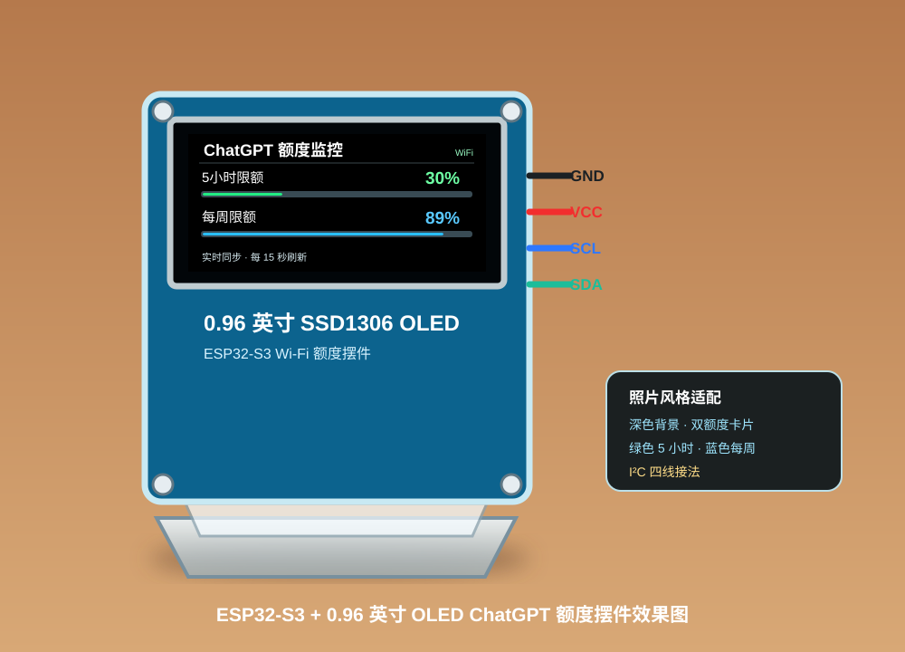
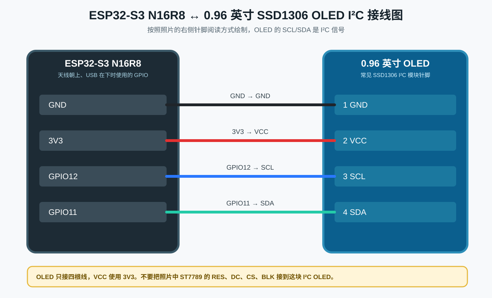
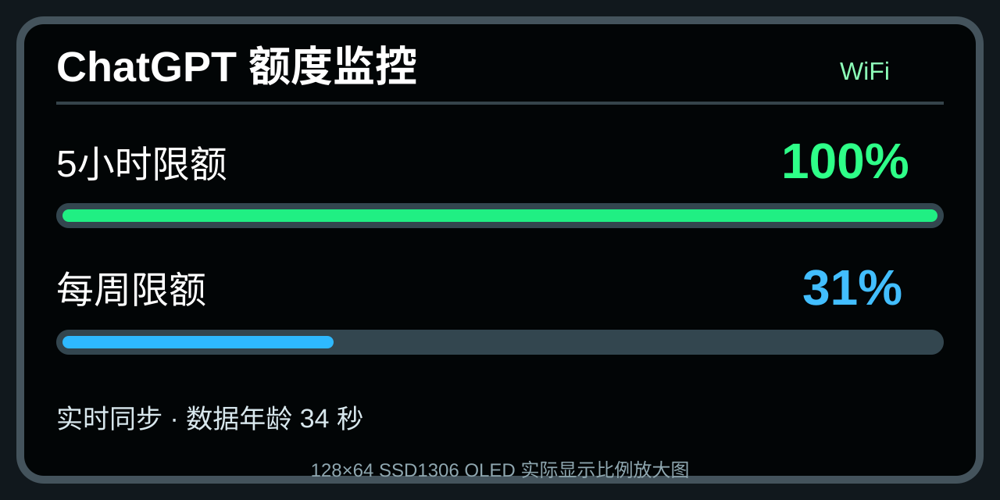
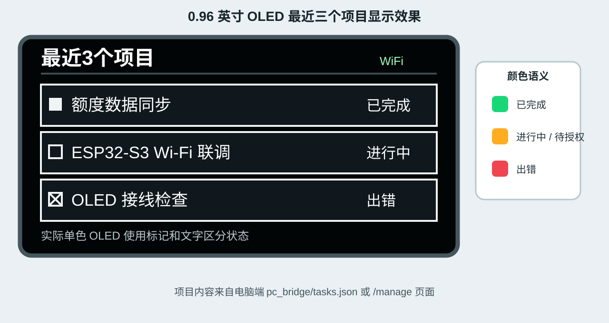

# ESP32-S3 + 0.96 英寸 OLED ChatGPT 额度摆件

这个版本按照你提供的两张照片重新适配。

- 第一张照片提供界面方向，保留 ChatGPT、5 小时限额、每周限额和深色卡片式显示。
- 第二张照片提供接线阅读方式。0.96 英寸 OLED 使用 I²C 四线接口，所以只保留 GND、VCC、SCL、SDA。
- 屏幕上同时显示两个剩余百分比。每 6 秒切换到重置时间页，再切回额度页。
- 屏幕每 6 秒切换到最近三个项目页，显示项目名称和项目状态。
- ESP32-S3 通过 Wi-Fi 每 15 秒从电脑端桥接服务读取一次数据。
- 电脑端桥接服务接收 Edge 中已经显示的 ChatGPT Usage 页面文字，不读取密码、Cookie 或 Token。

## 目录结构

    ChatGPT_Usage_Monitor_OLED096/
    ├─ ChatGPT_Usage_Monitor/
    │  └─ ChatGPT_Usage_Monitor.ino
    ├─ pc_bridge/
    │  ├─ bridge.py
    │  ├─ start_bridge.bat
    │  ├─ stop_bridge.bat
    │  ├─ install_autostart.bat
    │  ├─ install_autostart.ps1
    │  ├─ uninstall_autostart.bat
    │  ├─ uninstall_autostart.ps1
    │  └─ tasks.json
    ├─ edge_extension/
    │  ├─ manifest.json
    │  ├─ content.js
    │  └─ background.js
    └─ docs/
       ├─ effect_mockup.svg
       ├─ wiring_diagram.svg
       ├─ oled_screen_preview.svg
       ├─ oled_screen_preview.png
       ├─ oled_projects_preview.svg
       └─ oled_projects_preview.png

## OLED 接线

请先确认 OLED 模块丝印。常见 0.96 英寸 SSD1306 I²C 模块从上到下是 GND、VCC、SCL、SDA。

| OLED 引脚 | ESP32-S3 N16R8 | 说明 |
|---|---:|---|
| GND | GND | 电源地 |
| VCC | 3V3 | 3.3 V 供电 |
| SCL | GPIO12 | I²C 时钟 |
| SDA | GPIO11 | I²C 数据 |

本项目没有使用 RES、DC、CS、BLK。这些是照片中 ST7789 SPI 屏幕才会出现的信号。照片里的 SCL/SDA 在 ST7789 上分别表示 SPI SCK/MOSI，换成 OLED 后才是 I²C SCL/SDA。

OLED 的地址默认写成 0x3C。如果屏幕完全没有响应，可以把固件中的 OLED_I2C_ADDRESS 改为 0x3D。

项目状态的颜色语义如下：

- 绿色表示已完成。
- 橙色表示正在进行或需要手动授权。
- 红色表示出错。

SSD1306 0.96 英寸 OLED 是单色屏幕，实际硬件使用实心标记、空心标记、叉号和状态文字区分三种状态。电脑端项目管理页面和效果图保留绿色、橙色、红色视觉区分。

## Arduino IDE

1. 安装 Arduino IDE。
2. 在开发板管理器中安装 esp32 by Espressif Systems。
3. 选择 ESP32S3 Dev Module。
4. 选择 ESP32-S3 实际连接的 COM 端口。
5. 在库管理器安装：
   - ArduinoJson 7.x
   - U8g2
6. 打开 ChatGPT_Usage_Monitor/ChatGPT_Usage_Monitor.ino。
7. 修改 Wi-Fi 名称、Wi-Fi 密码和电脑的局域网 IPv4：

    const char *WIFI_SSID = "你的 Wi-Fi 名称";
    const char *WIFI_PASSWORD = "你的 Wi-Fi 密码";
    const char *BRIDGE_URL = "http://电脑局域网IPv4:8765/usage";

8. 点击“验证”，再点击“上传”。
9. 打开串口监视器，设置为 115200，可以看到 Wi-Fi 和额度请求状态。

电脑 IPv4 可以在 Windows 命令提示符中执行：

    ipconfig

示例：

    const char *BRIDGE_URL = "http://192.168.1.23:8765/usage";

## 电脑端实时桥接

电脑和 ESP32 必须连接同一个局域网。

### 启动桥接

在资源管理器打开 pc_bridge 文件夹，在地址栏输入 cmd 并回车，然后执行：

    py bridge.py

也可以直接双击 start_bridge.bat。

启动后可以打开：

- http://127.0.0.1:8765/health 检查服务。
- http://127.0.0.1:8765/usage 查看 ESP32 将读取的 JSON。
- http://127.0.0.1:8765/manage 编辑上一版 TFT 任务列表。OLED 版本不显示任务列表，但保留该页面便于后续扩展。

第一次运行时，如果 Windows 防火墙弹窗出现，请允许 Python 在“专用网络”通信。不要把 8765 端口映射到公网。

### 安装 Edge 扩展

1. 在 Edge 打开 edge://extensions。
2. 打开“开发人员模式”。
3. 点击“加载解压缩的扩展”。
4. 选择本项目的 edge_extension 文件夹。
5. 在已登录 ChatGPT 的 Edge 中打开 Settings → Usage 页面。
6. 保持 Usage 页面打开。扩展大约每 30 秒读取一次页面上可见的两个剩余百分比。
7. 打开 http://127.0.0.1:8765/usage，看到 "valid": true 后，ESP32 会在下一次轮询时显示真实数据。

## 屏幕显示

额度页会显示：

- 5小时限额的剩余百分比和进度条。
- 每周限额的剩余百分比和进度条。
- Wi-Fi、桥接服务和数据年龄状态。

重置页会显示：

- 5小时重置。
- 每周重置。

项目页会显示三个最近项目。每一行包含项目名称和状态文字：

- 已完成
- 进行中
- 待授权
- 出错

没有可用数据时屏幕显示 --%，并标记“等待 Usage 数据”或“电脑桥接离线”。

## 电脑开机后自动启动桥接

在电脑上只需要安装一次自动启动项。进入 pc_bridge 文件夹，双击：

    install_autostart.bat

这个脚本会在当前 Windows 用户的启动目录创建一个隐藏运行的桥接快捷方式。以后每次 Windows 登录后，bridge.py 会自动启动并监听 8765 端口。

用浏览器打开下面的地址检查自动桥接是否正常：

    http://127.0.0.1:8765/health

如果看到 ok 为 true，说明电脑桥接服务已经运行。需要取消自动启动时，双击：

    uninstall_autostart.bat

手动启动仍然可以使用 start_bridge.bat，停止当前服务可以使用 stop_bridge.bat。Edge 的 Usage 页面需要保持登录和打开状态。浏览器扩展只会读取当前页面上已经显示的文字，网页关闭或页面结构变化时，屏幕会显示数据过期或等待数据。

## 故障排查

- 屏幕完全不亮：先检查 VCC=3V3、GND 和 OLED 地址 0x3C/0x3D。
- 屏幕亮但没有文字：检查 SCL=GPIO12、SDA=GPIO11，并确认选择的是 ESP32S3 Dev Module。
- 一直显示“Wi-Fi 离线”：检查 2.4 GHz Wi-Fi 名称和密码。
- 一直显示“电脑桥接离线”：确认 py bridge.py 正在运行，且固件里的 IP 是电脑局域网 IPv4。
- valid 一直是 false：保持已登录的 Usage 页面打开并刷新一次，然后查看 /usage。
- 额度页面显示异常：扩展依赖 Usage 页面中可见的“5 小时限额”和“每周限额”文字。页面改版时需要同步调整 edge_extension/content.js 的解析规则。

