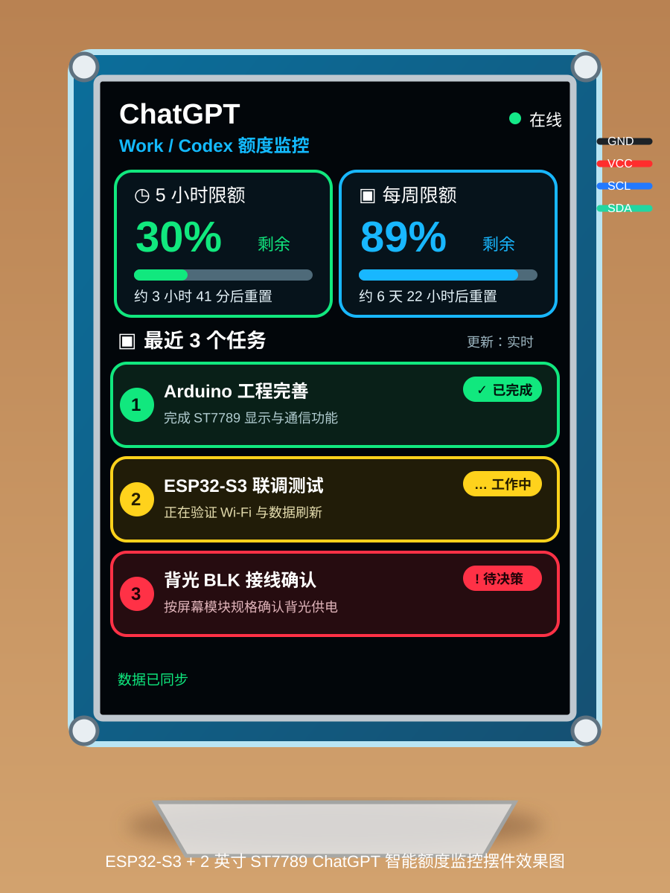
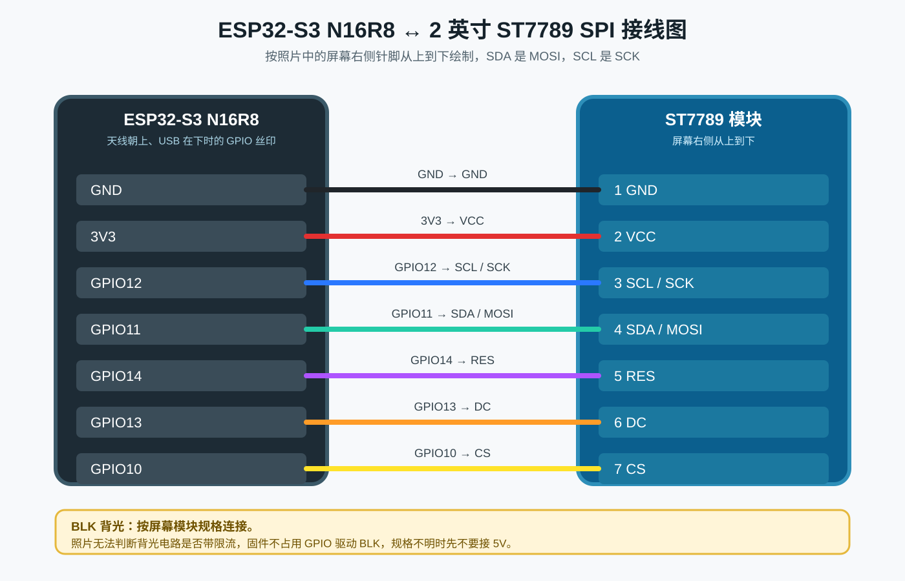

# ESP32-S3 ChatGPT 额度摆件（照片版）

这个项目按你提供的两张照片制作。最终硬件是 **ESP32-S3 N16R8 + 2 英寸 240×320 ST7789 SPI 彩屏**，屏幕右侧使用照片中的 8 针顺序，界面保留照片里的双额度卡片和最近三个任务窗口。





原始参考照片也保存在 `docs/reference_effect.jpg` 和 `docs/reference_wiring.jpg`。

> 你最初提到过 0.96 英寸 OLED。照片中的屏幕已经确定为 ST7789 SPI，本项目的固件、接线和安装步骤均以这块 2 英寸屏为准。

## 功能

- 显示 ChatGPT Work / Codex 的 **5 小时限额**。
- 显示 **每周限额**。
- 显示剩余百分比、进度条和页面提供的重置时间。
- 显示最近三个不同任务，绿色表示已完成，黄色表示工作中，红色表示有错误或需要决策。
- ESP32 每 15 秒从电脑桥接服务读取一次数据，屏幕每秒刷新状态。
- Edge 扩展只读取已登录 Usage 页面中已经显示的文字，不读取密码、Cookie 或 Token。

## 文件结构

```text
ChatGPT_Usage_Monitor_ST7789_PhotoEdition/
├─ ChatGPT_Usage_Monitor/
│  └─ ChatGPT_Usage_Monitor.ino       # Arduino 固件
├─ pc_bridge/
│  ├─ bridge.py                       # 电脑端本地桥接服务
│  ├─ tasks.json                      # 最近三个任务
│  ├─ start_bridge.bat                # Windows 启动
│  └─ stop_bridge.bat                 # Windows 停止
├─ edge_extension/
│  ├─ manifest.json
│  ├─ content.js                      # 读取 Usage 页可见额度
│  └─ background.js                   # 发送到 127.0.0.1:8765
└─ docs/
   ├─ effect_mockup.svg               # 按照片布局绘制的效果图
   ├─ wiring_diagram.svg              # 按照片引脚映射绘制的接线图
   ├─ reference_effect.jpg            # 你提供的效果图
   └─ reference_wiring.jpg            # 你提供的接线图
```

## 照片对应的接线

屏幕右侧从上到下是 `GND、VCC、SCL、SDA、RES、DC、CS、BLK`。

| 屏幕引脚 | ESP32-S3 N16R8 | 作用 |
|---|---:|---|
| GND | GND | 电源地 |
| VCC | 3V3 | 3.3 V 供电，先核对屏幕模块规格 |
| SCL | GPIO12 | SPI 时钟 SCK |
| SDA | GPIO11 | SPI 数据 MOSI |
| RES | GPIO14 | 屏幕复位 |
| DC | GPIO13 | 数据 / 命令选择 |
| CS | GPIO10 | SPI 片选 |
| BLK | 按模块规格 | 背光供电或背光使能 |

照片中的 `SDA` 是 SPI MOSI，照片中的 `SCL` 是 SPI SCK。它们在本项目中都不是 I2C 信号。

### BLK 背光

照片无法确定这块屏幕背光电路是否带限流和驱动。先查看卖家规格，再按规格把 BLK 接到 3V3 或背光控制电路。固件没有占用 ESP32 GPIO 来驱动 BLK。规格不明确时先保持 BLK 不接，避免把裸背光 LED 直接接到电源或 GPIO。

## Arduino IDE 操作

1. 安装 Arduino IDE。
2. 在“开发板管理器”安装 **esp32 by Espressif Systems**。
3. 选择 `ESP32S3 Dev Module`，选择实际 COM 端口。
4. 在库管理器安装：
   - `Adafruit GFX Library`
   - `Adafruit ST7735 and ST7789 Library`
   - `ArduinoJson` 7.x
   - `U8g2_for_Adafruit_GFX`
5. 打开 `ChatGPT_Usage_Monitor/ChatGPT_Usage_Monitor.ino`。
6. 修改这三项：

```cpp
const char *WIFI_SSID = "你的 Wi-Fi 名称";
const char *WIFI_PASSWORD = "你的 Wi-Fi 密码";
const char *BRIDGE_URL = "http://电脑局域网IPv4:8765/usage";
```

7. USB 连接 ESP32-S3，点击“验证”，再点击“上传”。串口监视器设置为 `115200`。

## 电脑端桥接服务

电脑和 ESP32 必须连接同一个局域网。

### 启动

在 Windows 资源管理器中打开项目的 `pc_bridge` 文件夹，在地址栏输入 `cmd` 回车，然后执行：

```bat
py bridge.py
```

也可以双击 `start_bridge.bat`。服务地址如下：

- `http://127.0.0.1:8765/manage`：编辑最近三个任务。
- `http://127.0.0.1:8765/usage`：查看 ESP32 使用的 JSON 数据。
- `http://127.0.0.1:8765/health`：检查服务是否启动。

第一次运行后，Windows 防火墙需要允许 Python 在“专用网络”接收连接。不要把 8765 端口映射到公网。

### Edge 扩展

1. Edge 打开 `edge://extensions`。
2. 打开“开发人员模式”。
3. 点击“加载解压缩的扩展”，选择项目的 `edge_extension` 文件夹。
4. 在已登录 ChatGPT 的 Edge 中打开“Settings → Usage”页面。
5. 保持该页面打开。扩展约每 30 秒读取一次页面上显示的两个剩余百分比，并把数据发送给 `bridge.py`。
6. 打开 `http://127.0.0.1:8765/usage`，看到 `"valid": true` 后，ESP32 下一次轮询会显示真实数据。

电脑 IPv4 可在命令提示符中执行：

```bat
ipconfig
```

把无线网卡或以太网卡的 IPv4 填入固件 `BRIDGE_URL`，例如：

```cpp
const char *BRIDGE_URL = "http://192.168.1.23:8765/usage";
```

## 最近三个任务

打开 `http://127.0.0.1:8765/manage`，填写三个任务名称、说明和状态。屏幕颜色对应如下：

- 绿色：已完成
- 黄色：工作中
- 红色：有错误或需要决策

任务内容存放在 `pc_bridge/tasks.json`。额度快照只保存在运行中的 `bridge.py` 内存中，重启电脑端服务后需要重新打开 Usage 页面等待扩展上报。

## 数据来源和刷新说明

这套方案通过浏览器扩展同步 Usage 页面上已经显示的文字。它没有调用 ChatGPT 内部套餐接口。页面关闭、电脑休眠、扩展被停用或网页结构变化时，屏幕会显示等待数据、桥接离线或数据过期。屏幕只把剩余百分比作为进度条，不把已用百分比当作剩余百分比。

## 故障排查

- **背光亮但没有图像**：逐根核对 `SCL/GPIO12、SDA/GPIO11、RES/GPIO14、DC/GPIO13、CS/GPIO10`，并确认屏幕确实是 ST7789。
- **屏幕完全不亮**：检查 `VCC=3V3、GND` 和 BLK 的模块规格接法。
- **显示 Wi-Fi 未连接**：核对 SSID、密码和 2.4 GHz Wi-Fi 设置。
- **显示电脑桥接离线**：确认 `py bridge.py` 正在运行、ESP32 中的电脑 IPv4 正确、Windows 防火墙允许专用网络。
- **`valid` 一直是 false**：保持已登录的 ChatGPT Usage 页面打开，刷新页面后再查看扩展和 `/usage`。
- **颜色反相或方向不对**：在 `.ino` 中调整 `TFT_INVERT` 或 `TFT_ROTATION`。
